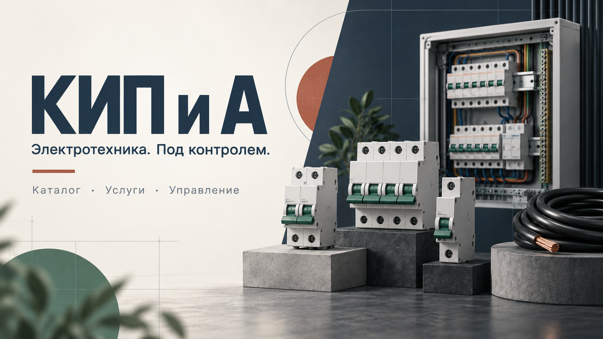
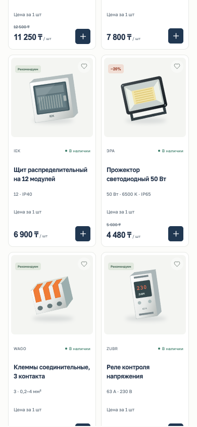
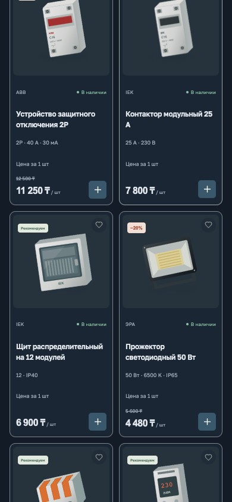
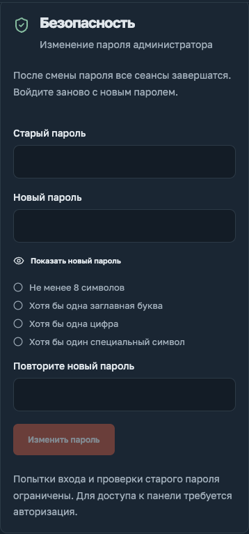
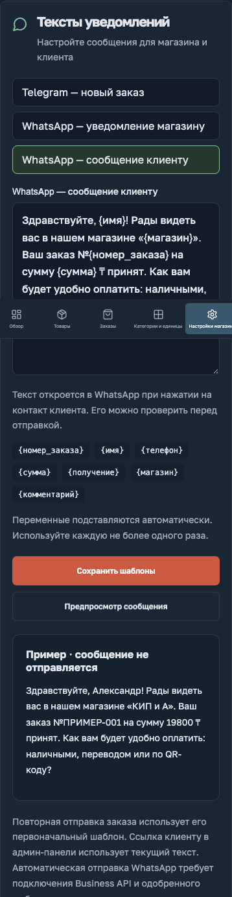
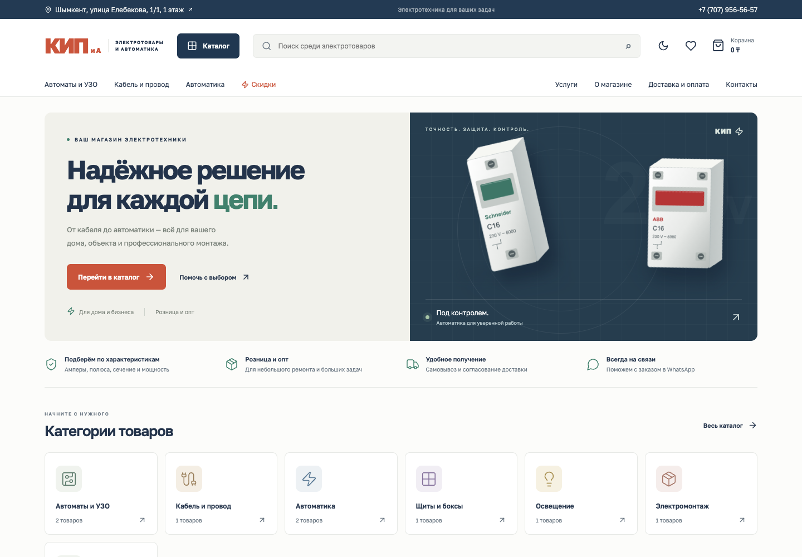
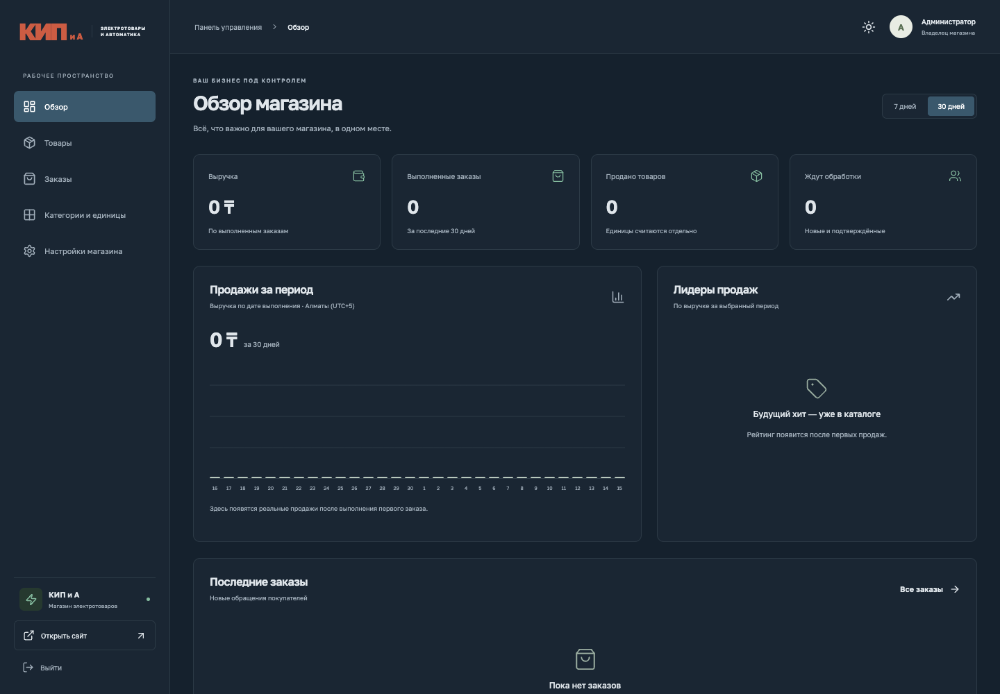
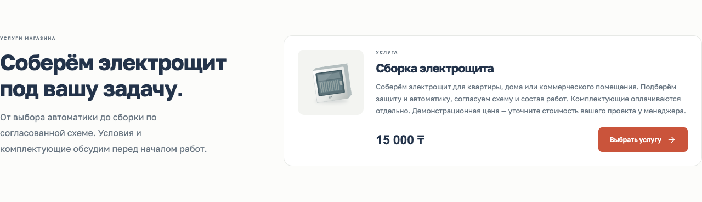

# КИП и А

### Электротехника. Под контролем.


**[Магазин в 2ГИС](https://2gis.kz/shymkent/firm/70000001088167656)** · **[Развёртывание](docs/DEPLOYMENT.md)** · **[Руководство администратора](docs/OPERATIONS.md)**



Интернет-магазин электротоваров и услуг по сборке электрощитов для «КИП и А» в Шымкенте. Покупатель выбирает оборудование и услуги, оформляет заказ, а магазин управляет каталогом, продажами и уведомлениями в одной панели.

> В репозитории — исходный код, документация и презентационные изображения. Рабочая база, заказы, пароли, токены и результаты тестовых запусков в Git не входят. На снимках — демонстрационный каталог; новая production-база создаётся без демонстрационных товаров и заказов.

## Интерфейс

|                                           Светлая тема                                           |                                          Тёмная тема                                           |                                          Безопасность                                           |                                               Сообщения                                                |
| :----------------------------------------------------------------------------------------------: | :--------------------------------------------------------------------------------------------: | :---------------------------------------------------------------------------------------------: | :----------------------------------------------------------------------------------------------------: |
|  |  |  |  |

<details>
<summary><strong>Витрина на компьютере</strong></summary>



</details>

<details>
<summary><strong>Панель управления</strong></summary>



</details>

<details>
<summary><strong>Услуги по сборке электрощитов</strong></summary>



</details>

Обложка — иллюстрация, созданная с помощью генерации изображений. Галерея — настоящие снимки интерфейса в изолированном демонстрационном окружении, без заказов и персональных данных покупателей. [Происхождение изображений](artifacts/readme/README.md).

## Возможности

- **Каталог для электромонтажа.** Категории, поиск, сортировка, избранное, характеристики и скидки. Варианты номиналов — внутри одной карточки.
- **Товары и услуги.** Кабель продаётся в метрах, оборудование — в штуках, сборка щита — отдельной услугой без складского остатка.
- **Оформление заказа.** Казахстанский номер с фиксированным `+7`, проверка имени, самовывоз или доставка, комментарий. Цены и суммы рассчитываются на сервере.
- **Контроль остатков.** Транзакционное резервирование, защита от повторных заказов и перепродажи последней единицы, возврат остатка при отмене.
- **Рабочее место администратора.** Создание и редактирование каталога, загрузка фото, справочники единиц, статусы заказов и контакт клиента в WhatsApp.
- **Аналитика.** Выполненные заказы и выручка за 7 / 30 дней, количество по единицам продажи, дневной график и лидеры продаж.
- **Уведомления.** Очередь Telegram / WhatsApp, повторные попытки, редактируемые тексты с предпросмотром. Автоматическая отправка требует собственных ключей интеграций.
- **Защита панели.** Серверная авторизация, ограничение попыток входа, смена пароля через старый пароль, требования к сложности и отзыв всех сессий после смены.

## Дизайн

Спокойная промышленная палитра, заметные действия и единая система светлой и тёмной тем.

| Элемент                | Решение                                                 |
| ---------------------- | ------------------------------------------------------- |
| Основной цвет          | Глубокий синий `#203751`                                |
| Акцент                 | Терракотовый `#CA543B`                                  |
| Подтверждение и детали | Приглушённый зелёный `#41816D`                          |
| Типографика            | Golos Text с кириллицей                                 |
| Адаптивность           | Проверены ширины 320, 390, 768, 1024 и 1440 px в Chrome |

## Как устроен проект

```text
Браузер → Nginx → FastAPI / Uvicorn (1 процесс)
                     ├── React: готовые файлы dist/
                     ├── SQLite: товары, заказы, настройки, сессии
                     └── Очередь уведомлений → Telegram / WhatsApp API
```

**База сейчас — SQLite**, доступ через `aiosqlite`, режим WAL. Отдельный сервер PostgreSQL/MySQL не нужен. Фотографии хранятся рядом с базой в `uploads/`. Данные production размещаются отдельно от исходного кода.

**Docker необязателен.** Существующий Dockerfile собирает React в первом этапе, а во втором запускает FastAPI с этой сборкой. Это и сборка, и запуск контейнера. В разработке сейчас используется обычный Uvicorn. Для сервера с 1 CPU / 2 ГБ RAM и другими сайтами подготовлен путь **без Docker: systemd + существующий Nginx**. Node.js нужен для сборки, а не для постоянного обслуживания сайта.

```text
backend/app/         API, бизнес-правила, SQLite и интеграции
src/                 React + TypeScript, витрина и админ-панель
public/              Изображения и статические файлы сайта
scripts/             Начальная настройка, резервное копирование
backend/tests/       Исходники тестов API и бизнес-правил
tests/e2e/           Исходники браузерных проверок
artifacts/readme/    Изображения, предназначенные для публикации
deploy/              Образцы systemd, Nginx и production-настроек
docs/                Эксплуатация и пошаговое развёртывание
```

## Локальный запуск

Python 3.12+ и Node.js 22+; следующие команды выполняются из папки проекта.

```bash
python3 -m venv .venv
.venv/bin/pip install -r backend/requirements.lock
npm ci
python3 scripts/setup.py
npm run build
.venv/bin/python -m uvicorn backend.app.main:app --host 127.0.0.1 --port 8000
```

| Команда                                    | Для чего                                                                        |
| ------------------------------------------ | ------------------------------------------------------------------------------- |
| `python3 -m venv .venv`                    | Изолированное окружение Python                                                  |
| `pip install -r backend/requirements.lock` | Зависимости с зафиксированными версиями                                         |
| `npm ci`                                   | Зависимости интерфейса по lock-файлу                                            |
| `python3 scripts/setup.py`                 | Первоначальный пароль и локальный `.env`; существующий файл не перезаписывается |
| `npm run build`                            | Готовый интерфейс в `dist/`                                                     |
| `uvicorn …`                                | API и раздача интерфейса одним сервером                                         |

Откройте [магазин](http://127.0.0.1:8000) или [админ-панель](http://127.0.0.1:8000/admin). Первоначальный пароль — в локальном `admin-access.txt`; сохраните его в менеджере паролей и удалите файл.

Новая база по умолчанию содержит контакты магазина, категории и единицы, но **не содержит товары, услуги, заказы и клиентов**. Для локальной демонстрации задайте `SEED_DEMO_DATA=true` **до первого запуска новой базы**. Флаг не удаляет и не заменяет уже существующие данные. В production оставьте `false`.

## Git и публикация

[`.gitignore`](.gitignore) исключает зависимости, сборки, `.env`, пароли, все SQLite-файлы и их журналы, загрузки, резервные копии, логи, отчёты, coverage и необработанные тестовые артефакты.

В Git входят исходники, lock-файлы, конфигурации-примеры без секретов, публичные изображения сайта и **выбранные изображения `artifacts/readme/`**. Исходники тестов остаются для разработки; они не запускаются production-сервисом. `dist/` доставляется отдельным архивом сборки, а не коммитится.

Инструкции по первоначальной публикации и получению обновлений — в [руководстве по развёртыванию](docs/DEPLOYMENT.md). `.gitignore` не удаляет файлы из уже существующей истории Git: перед публикацией проверьте индекс.

## Проверки

```bash
npm run build
npm run format:check
.venv/bin/python -m pytest backend/tests -q
npm run test:e2e
```

Playwright использует Google Chrome, временную базу и отдельный порт 8001. Внешние уведомления отключены. Тестовые данные не переносятся на рабочий сервер. Для сервера 1 CPU / 2 ГБ RAM запускайте тесты и сборку локально или в CI.

## Развёртывание

[Пошаговая инструкция с назначением каждой команды →](docs/DEPLOYMENT.md)

Отдельные пользователь, каталог, база, порт и systemd-сервис. Собственный Nginx server block, проверка `nginx -t`, затем reload. Перед началом нужны инвентаризация сервера, свободный порт и замер доступной памяти. Ресурсные лимиты — стартовые настройки, а не гарантия достаточной мощности для всех сайтов.

## Документация и источники

- [Эксплуатация, интеграции, пароль и резервные копии](docs/OPERATIONS.md).
- [Развёртывание без Docker](docs/DEPLOYMENT.md).
- [Данные магазина в 2ГИС](https://2gis.kz/shymkent/firm/70000001088167656).
- [README Hafiz — референс структуры презентации](https://github.com/abbosoktambayev/hafiz-showcase). Тексты и изображения этого проекта подготовлены отдельно.

Оплата согласуется с менеджером; онлайн-эквайринг не подключён. Домен, TLS и внешние сервисы настраиваются при развёртывании.
